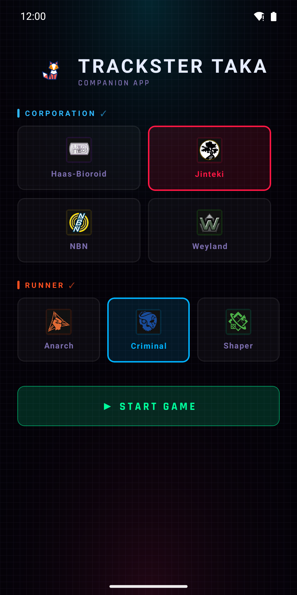
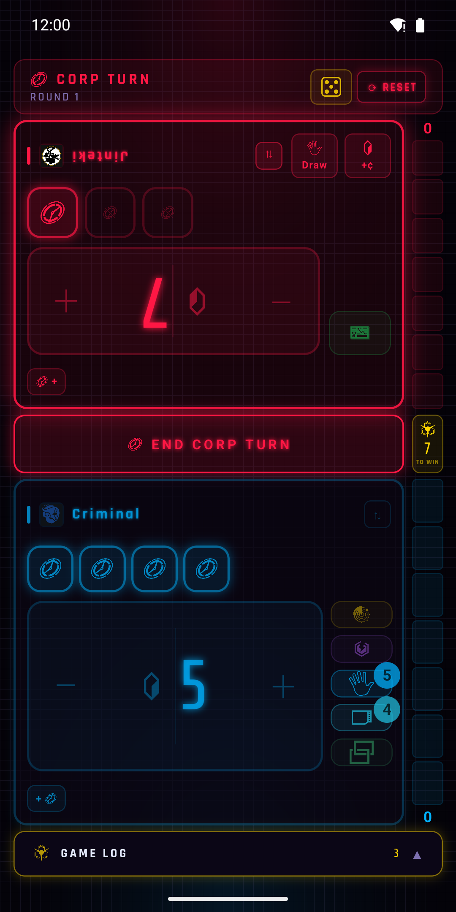
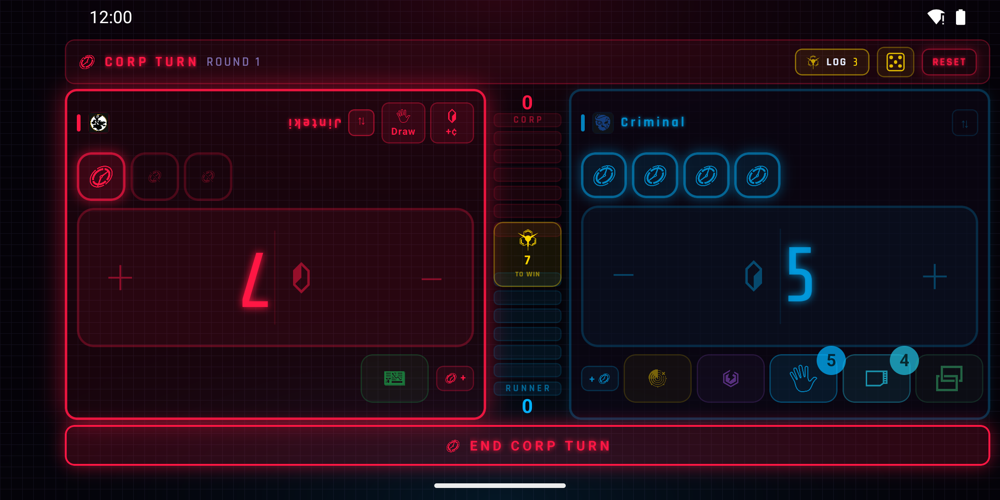

# Trackster Taka

Trackster Taka is an unofficial companion app for the [Netrunner LCG](https://nullsignal.games/). It tracks credits, clicks, agenda points, tags, core damage, bad publicity, MU, hand size, and link on one screen. It runs in the browser, on Android, and on iOS, and is built with React Native and Expo (TypeScript).

**[Try it in your browser](https://salvob41.github.io/trackster-taka/)**

| Setup | Game, portrait | Game, landscape |
| --- | --- | --- |
|  |  |  |

## How it works

### Setup

Pick a Corp faction, a Runner faction, or one of each, then tap **START GAME**. The selection sets the game mode:

- One of each tracks both sides on one device.
- A single faction tracks only your side, for when your opponent sits across the table.

Tap a selected faction again to deselect it.

### Game screen

Each side has these controls:

- Click tokens at the top. Tap one to spend a click.
- A credit counter. Tap its left half to subtract a credit and its right half to add one.
- **Draw** and **+¢** buttons. Each one spends a click and logs the action.
- A small **+** button that cycles extra clicks from 0 to 3, for cards that grant more clicks.
- Stat chips. The Corp has bad publicity. The Runner has tags, core damage, hand size, MU, and link.
- A **⇅** button that turns the panel 180 degrees, so the player across the table can read it.

The agenda ladder shows both scores. Tap a side's ladder to add an agenda point, and long-press it to remove one. The center cell shows the win target, which defaults to 7. Tap it to choose a target from 1 to 10.

In single-side mode, the header has an opponent chip that shows the opponent's agenda points. Tap the chip's second counter to add a tag to the Runner or bad publicity to the Corp, and long-press it to remove one. Enter the opponent's agenda points on the ladder.

The die button in the header opens a sheet that rolls a d2, d3, d6, or d20, or picks a random mark (HQ, R&D, or Archives). The mark stays on screen as a chip.

Portrait stacks the Corp above the Runner. Landscape puts them side by side with the ladder between them.

### Game log and win screen

The game log records every action with its round and side. Open it with **GAME LOG** at the bottom in portrait, or the **LOG** chip in the header in landscape.

When a side reaches the win target, a win screen shows the winning faction and a **NEW GAME** button.

The screen stays on while the app is open. Dice rolls, mark picks, and win target changes give haptic feedback.

## Run locally

Install the dependencies first:

```bash
npm install
```

Start the web version:

```bash
npm run web
```

Start Metro and scan the QR code with Expo Go on a phone:

```bash
npm start
```

### Android emulator

You need JDK 17 and the Android SDK command line tools, with `ANDROID_HOME` set. Install the emulator and an Android 16 (API 36) system image, then create a virtual device. On an Intel Mac, replace `arm64-v8a` with `x86_64`.

```bash
sdkmanager "emulator" "platform-tools" "system-images;android-36;google_apis_playstore;arm64-v8a"
avdmanager create avd -n pixel8_api36 -d pixel_8 \
  -k "system-images;android-36;google_apis_playstore;arm64-v8a"
```

Boot the emulator, then build and install the debug app:

```bash
$ANDROID_HOME/emulator/emulator -avd pixel8_api36
npx expo run:android --device pixel8_api36
```

`--device` takes the virtual device name, not the `emulator-5554` serial. The first Gradle build takes several minutes.

The debug build is much slower than a release build. After a screen rotation, Android can show an "isn't responding" dialog. Tap **Wait**.

## Build

The release workflows build the Android app, so a local release build is rarely needed. To build an APK locally:

```bash
npx expo prebuild --platform android
cd android && ./gradlew assembleRelease
```

To build the static web site into `dist/`:

```bash
npx expo export --platform web
```

## CI and releases

| Workflow | Runs on | What it does |
| --- | --- | --- |
| `ci.yml` | Pull requests and pushes to `main` | Runs `tsc --noEmit` and the Jest tests. |
| `deploy-web.yml` | Pushes to `main` | Deploys the web version to GitHub Pages. |
| `build-apk.yml` | `v*` tags | Builds the sideload APK and attaches it to the GitHub release. |
| `build-aab.yml` | `v*` tags | Builds the signed Play Store AAB and attaches it to the GitHub release. |

To ship a release:

1. Bump `version` and `android.versionCode` in `app.json`.
2. Add the release to the top of `RELEASE_NOTES.md`.
3. Merge to `main`, then push a `vX.Y.Z` tag.

The Android workflows sign the app with the repo secrets `ANDROID_KEYSTORE_B64`, `ANDROID_KEYSTORE_PASSWORD`, `ANDROID_KEY_ALIAS`, and `ANDROID_KEY_PASSWORD`.

### Play Store listing

The store texts, screenshots, and feature graphic are in `fastlane/metadata/android/<language>/`. Screenshots upload in filename order, so prefix them `1_`, `2_`, and so on.

1. Install fastlane with `brew install fastlane`.
2. Save the Play Console service account key as `play-service-account.json` in the repo root. Git ignores this file.
3. The first time only, run `fastlane supply init` to download the current listing.
4. Run `fastlane metadata` to upload the listing. This lane does not upload an app build.

Google Play rejects phone screenshots longer than 2:1, and the Pixel 8 screen is 1080x2400. Change the emulator display to 1080x2160 before you capture, and restore it afterwards:

```bash
adb shell wm size 1080x2160
adb exec-out screencap -p > shot.png
adb shell wm size reset
```

## Code layout

```
src/
├── App.tsx        # entry point, intro, picks the portrait or landscape screen
├── theme.ts       # colors, fonts, factions
├── state.ts       # game state and rules, no React imports
├── hooks/         # useGameState, useBatchedDelta
├── screens/       # SetupScreen, GameScreen, GameScreenLandscape
├── components/    # counters, ladders, chips, sheets, overlays
└── assets/        # icons, fonts, backdrop images
plugins/           # Expo config plugin that trims Android permissions
fastlane/          # Play Store listing lane and metadata
```

`state.ts` holds every rule decision. The screens map state to widgets and call its handlers.

## Credits

- Game: [Null Signal Games](https://nullsignal.games/), formerly NISEI and FFG
- Icons: [NSG Visual Assets](https://nullsignal.games/about/resources/)
- Hand icon: [Kalashnyk on Flaticon](https://www.flaticon.com/free-icon/five_9437501)
- App icon: [Fox animated icons created by Freepik - Flaticon](https://www.flaticon.com/free-animated-icons/fox)
- Android adaptive icon (foreground, background, and monochrome layers): generated with [Icon Kitchen](https://icon.kitchen/)
- Built with [Expo](https://expo.dev/) and [React Native](https://reactnative.dev/)

## License

The code is licensed under the **Apache License 2.0**. See [LICENSE](./LICENSE) and [NOTICE.md](./NOTICE.md).

Bundled third-party assets keep their own licenses, which Apache-2.0 does not cover. The Null Signal Games icons use CC BY-ND 4.0. The Flaticon icons (hand and fox app icon) use the Flaticon license. [NOTICE.md](./NOTICE.md) has the full attributions.

This is an unofficial fan project. Null Signal Games, Fantasy Flight Games, and Wizards of the Coast do not endorse it and are not affiliated with it. *Android: Netrunner* and related marks are trademarks of their respective owners.
